<p align="center">
  
</p>

```console
$ whoami --verbose
Jacopo Vendramin  //  Full Stack Engineer @ ekar-is  //  Vicenza, IT
practical person, passionate about every phase of software development
```

### `ls ~/projects --original-only`

| project | what it does | stack |
|---|---|---|
| [**accio**](https://github.com/JacopoVendramin/accio) | Terminal UI for AWS credentials: SSO, MFA, role chaining, SAML, secrets in the OS keychain | `Go` |
| [**lakehouse-orchestrator**](https://github.com/JacopoVendramin/lakehouse-orchestrator) | One-command lakehouse: CSV to Iceberg via event-driven Airflow, Trino, Superset | `Python` `Go` `Docker` |
| [**redshiftEmulator**](https://github.com/JacopoVendramin/redshiftEmulator) | Local Amazon Redshift on PostgreSQL 16, test Redshift SQL without AWS | `PLpgSQL` `Docker` |

### `ping jacopo`

[](https://www.linkedin.com/in/vendraminjacopo/)
[](https://github.com/JacopoVendramin)
